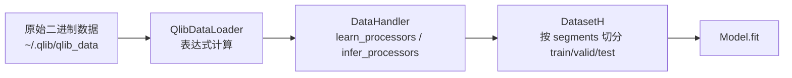

# 第 4 课：DataHandler 与特征工程（Alpha158 / Alpha360 / 自定义）

> 说明：根据学习进度提前更新本课。第 2、3 课大纲见文件末尾，后续补全。

## 学习目标

1. 理解 DataHandler 在 qlib 中的定位：数据 → 特征 → 标签的加工厂
2. 掌握 Alpha158 和 Alpha360 的构成、区别与适用场景
3. 能通过修改 label、processor 定制 Handler
4. 为后续自定义因子打下基础

## 一、DataHandler 是什么

DataHandler 是 qlib 数据流水线的**特征加工器**。输入是原始行情数据（close/open/high/low/volume/vwap），输出是模型可用的特征矩阵和标签。



核心源码位置：
- 基类：[qlib/data/dataset/handler.py](../../qlib/data/dataset/handler.py)
- 内置实现：[qlib/contrib/data/handler.py](../../qlib/contrib/data/handler.py)
- 因子加载器：[qlib/contrib/data/loader.py](../../qlib/contrib/data/loader.py)

配置三要素（YAML 中常见）：

| 配置项 | 作用 |
|--------|------|
| `instruments` | 股票池，如 `csi300` |
| `learn_processors` | 在训练数据上拟合的处理（标准化、去极值…） |
| `infer_processors` | 推理时直接应用的处理（训练集已拟合参数） |

## 二、Alpha158：158 个人工截面因子

源码定义：[Alpha158DL](../../qlib/contrib/data/loader.py)（因子列表）+ [Alpha158 Handler](../../qlib/contrib/data/handler.py#L98)

Alpha158 是 qlib 官方整理的 158 个横截面技术因子，都是量化研究中经典的量价指标：

- 动量类：`Mom`、`Ret`、`Mean` 不同周期
- 波动率类：`Std`、`Atr`、`MaxRet`
- 成交量类：`VolumeRatio`、`Vwap` 偏离
- 趋势类：均线偏离、MACD 变体
- 等等…合计 158 维

特点：
- 每个因子都有明确金融含义，可解释性强
- 以**截面**为主（同一交易日不同股票间比较）
- 是树模型（LightGBM / XGBoost）的黄金搭档
- 工程经验的沉淀，新手起步快

## 三、Alpha360：60 日原始量价序列 ⭐

源码定义：[Alpha360DL.get_feature_config()](../../qlib/contrib/data/loader.py#L16-L58)

### 3.1 因子构成：6 × 60 = 360

| 字段 | 维度 | 命名规则 | 表达式 |
|------|------|----------|--------|
| close 收盘价 | 60 | `CLOSE0` ~ `CLOSE59` | `Ref($close, i) / $close` |
| open 开盘价 | 60 | `OPEN0` ~ `OPEN59` | `Ref($open, i) / $close` |
| high 最高价 | 60 | `HIGH0` ~ `HIGH59` | `Ref($high, i) / $close` |
| low 最低价 | 60 | `LOW0` ~ `LOW59` | `Ref($low, i) / $close` |
| vwap 均价 | 60 | `VWAP0` ~ `VWAP59` | `Ref($vwap, i) / $close` |
| volume 成交量 | 60 | `VOLUME0` ~ `VOLUME59` | `Ref($volume, i) / ($volume+1e-12)` |

### 3.2 关键设计

1. **相对归一化**：所有值除以当日收盘价（成交量除以当日成交量），保证不同股票、不同价位可比
2. **锚点为 1**：`CLOSE0 = $close / $close = 1`，`VOLUME0 = 1`，是序列的"现在"
3. **原始信号**：不做人工因子构造，把 60 天的原始形态直接扔给模型，让深度学习自己提取模式
4. **越界填 NaN**：数据起点之前的 `Ref($close, 59)` 不存在，返回 NaN，由后续 processor 处理

### 3.3 适合模型

Alpha360 是为**时序深度学习模型**设计的：
- RNN 系列：LSTM、GRU、ALSTM、ADARNN
- CNN 系列：TCN
- 注意力系列：Transformer、Localformer、SFM
- 图模型：GATs、HIST
- 其他：TRA、TFT、TCTS、IGMTF、KRNN、Sandwich…

`examples/benchmarks/` 下每个模型都有 `_Alpha360.yaml` 配置，共 26 个。

## 四、Alpha158 vs Alpha360 对比

| 维度 | Alpha158 | Alpha360 |
|------|----------|----------|
| 特征数 | 158 | 360 |
| 设计思想 | 人工截面因子工程 | 原始时序信号，模型自提取 |
| 适用模型 | 树模型、线性模型 | 深度学习（LSTM/Transformer/TCN…） |
| 可解释性 | 高 | 低 |
| 计算量 | 小 | 大 |
| 基准 IC | 较高（经验沉淀） | 稍低，但模型潜力大 |
| 样本配置 | 所有模型均有 Alpha158 版 | 所有模型均有 Alpha360 版 |

**实践建议**：
1. 先用 Alpha158 + LightGBM 建立基线（训练快、易复现）
2. 再试 Alpha360 + 深度学习模型，看是否有提升
3. 进阶融合：Sandwich 模型就是把两者拼接使用

## 五、动手实践

### 实践 1：对比两者的特征形状

```python
import qlib
from qlib.constant import REG_CN
from qlib.utils import init_instance_by_config

qlib.init(provider_uri="~/.qlib/qlib_data/cn_data", region=REG_CN)

for name, cls in [("Alpha158", "Alpha158"), ("Alpha360", "Alpha360")]:
    ds = init_instance_by_config({
        "class": "DatasetH",
        "module_path": "qlib.data.dataset",
        "kwargs": {
            "handler": {
                "class": cls,
                "module_path": "qlib.contrib.data.handler",
                "kwargs": {"instruments": "csi300", "start_time": "2017-01-01", "end_time": "2017-12-31"},
            },
            "segments": {"train": ("2017-01-01", "2017-06-30")},
        },
    })
    df = ds.prepare("train")
    print(f"{name}: shape={df.shape}, 列名前5个={list(df.columns[:5])}")
```

预期输出：
- Alpha158：约 159 列（158 特征 + 1 标签）
- Alpha360：约 361 列（360 特征 + 1 标签）

### 实践 2：用 Alpha360 跑通 LightGBM

```bash
qrun examples/benchmarks/LightGBM/workflow_config_lightgbm_Alpha360.yaml
```

跑完后对比 Alpha158 版的 IC，体会两者差异。

### 实践 3：自定义标签

Alpha360 默认标签是未来 1 日收益（`Ref($close, -2)/Ref($close, -1) - 1`）。改成 5 日收益试试：

```yaml
handler:
    class: Alpha360
    module_path: qlib.contrib.data.handler
    kwargs:
        label: ["Ref($close, -5) / Ref($close, -1) - 1"]   # 4 天后的收益
```

## 六、自检清单

- [ ] 能说出 DataHandler 在 qlib 流水线中的位置
- [ ] 能解释 Alpha360 的 360 怎么算出来的（6 字段 × 60 天）
- [ ] 能说出 Alpha360 为什么除以当日 close（相对归一化）
- [ ] 能根据模型类型选择 Alpha158 还是 Alpha360
- [ ] 完成动手实践 1-3

## 学习记录

（学完后在此填写心得与疑问）

## 下节预告

第 5 课「模型层」：Model 基类接口、内置模型一览、自定义模型步骤。

---

## 附录：第 2、3 课大纲（待补全）

### 第 2 课：数据层（D 接口、表达式引擎、二进制存储）

- `qlib.data.D` 的常用方法：`calendar` / `instruments` / `list_instruments` / `features`
- 表达式引擎：`$字段`、`Ref`、`Mean`、`Std`、`Max`、`Corr` 等算子
- 二进制存储结构：`calendars/`、`instruments/`、`features/`
- 缓存机制：`disk_cache` 参数

### 第 3 课：工作流系统（qrun、配置模式 vs 代码模式）

- `qrun` 命令与 YAML 配置结构
- `init_instance_by_config` 三要素与递归实例化
- 占位符机制：`<MODEL>`、`<DATASET>`、`<PRED>`
- 代码模式：`workflow_by_code.py` 逐行精读
